<picture>
  <source media="(prefers-color-scheme: dark)" srcset="assets/header-dark.png">
  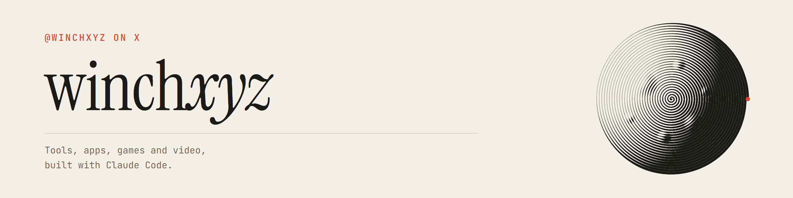
</picture>

I build whatever I need at the moment with Claude Code: AI tools I use every day, photo and design apps, browser games, motion videos, a converter from Minecraft builds to 3D prints. Everything here is open source, and most of it runs in the browser with nothing to install.

[X @winchxyz](https://x.com/winchxyz) &nbsp;·&nbsp; [winchxyz.github.io](https://winchxyz.github.io)

## Tools

<table>
<tr>
<td width="33%" valign="top">
<a href="https://tryloupe.app/">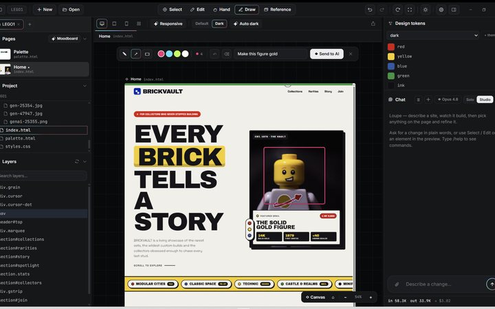</a>
 <b><a href="https://github.com/winchxyz/loupe">loupe</a></b>
 A local website builder for Windows. AI makes the site, you fix it by hand on the live page.
 <a href="https://tryloupe.app/">Site</a> &nbsp;·&nbsp; <a href="https://github.com/winchxyz/loupe">Code</a>
</td>
<td width="33%" valign="top">
<a href="https://github.com/winchxyz/idea-to-build">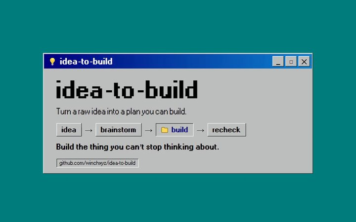</a>
 <b><a href="https://github.com/winchxyz/idea-to-build">idea-to-build</a></b>
 A Claude Code plugin that turns a raw idea into a plan, with a critic that argues back.
 <a href="https://github.com/winchxyz/idea-to-build">Code</a>
</td>
<td width="33%" valign="top">
<a href="https://github.com/winchxyz/motion-studio">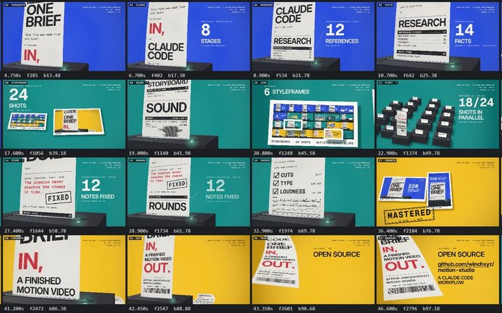</a>
 <b><a href="https://github.com/winchxyz/motion-studio">motion-studio</a></b>
 A Claude Code workflow that turns one brief into a finished motion video. Every frame is code.
 <a href="https://github.com/winchxyz/motion-studio">Code</a>
</td>
</tr>
<tr>
<td width="33%" valign="top">
<a href="https://winchxyz.github.io/crunch-time/">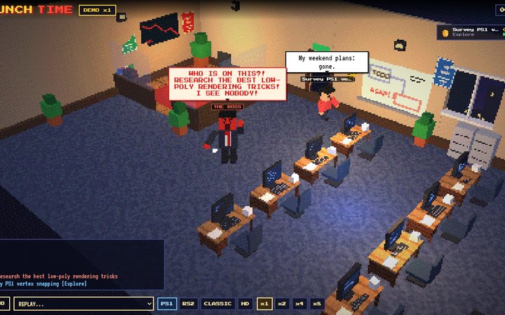</a>
 <b><a href="https://github.com/winchxyz/crunch-time">crunch-time</a></b>
 Watch your Claude Code agents work in a PS1-style office. The boss is your main session.
 <a href="https://winchxyz.github.io/crunch-time/">Open</a> &nbsp;·&nbsp; <a href="https://github.com/winchxyz/crunch-time">Code</a>
</td>
<td width="33%" valign="top">
<a href="https://github.com/winchxyz/x-ghostwriter">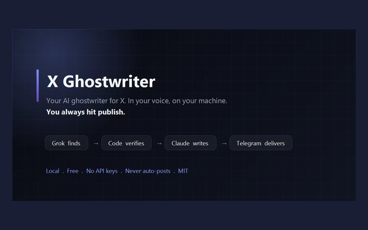</a>
 <b><a href="https://github.com/winchxyz/x-ghostwriter">x-ghostwriter</a></b>
 Drafts X posts and replies in your voice with n8n, Grok and Claude. You press publish.
 <a href="https://github.com/winchxyz/x-ghostwriter">Code</a>
</td>
<td width="33%" valign="top">
<a href="https://github.com/winchxyz/mc-print-3d">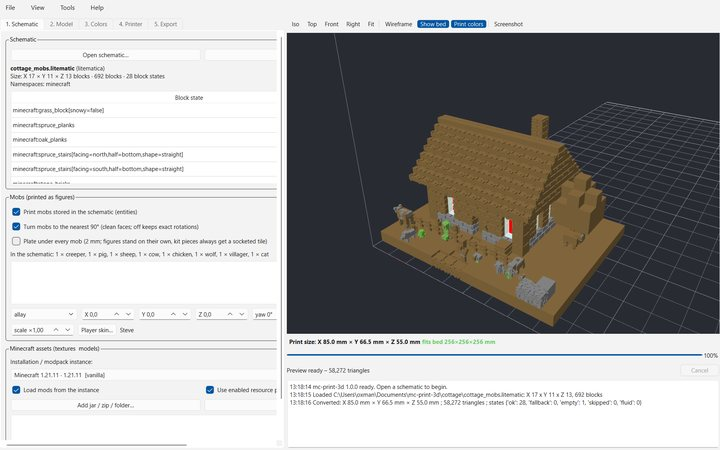</a>
 <b><a href="https://github.com/winchxyz/mc-print-3d">mc-print-3d</a></b>
 Turns Minecraft builds into multi-colour 3D-printable models.
 <a href="https://github.com/winchxyz/mc-print-3d">Code</a>
</td>
</tr>
</table>

## Photo and design apps

<table>
<tr>
<td width="33%" valign="top">
<a href="https://winchxyz.github.io/spiralist/">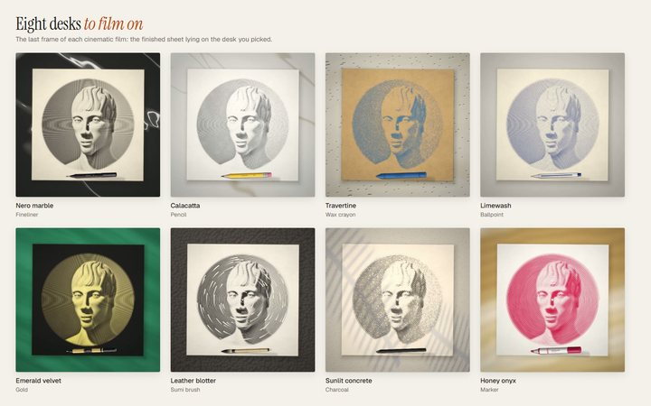</a>
 <b><a href="https://github.com/winchxyz/spiralist">spiralist</a></b>
 Turns a photo into a drawing made of one continuous line, and films it being drawn.
 <a href="https://winchxyz.github.io/spiralist/">Open</a> &nbsp;·&nbsp; <a href="https://github.com/winchxyz/spiralist">Code</a>
</td>
<td width="33%" valign="top">
<a href="https://winchxyz.github.io/typist/">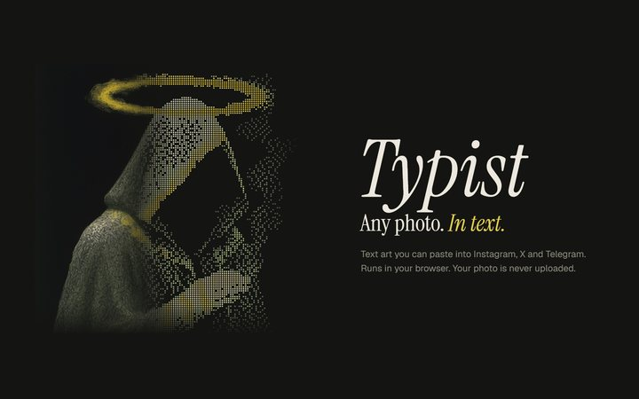</a>
 <b><a href="https://github.com/winchxyz/typist">typist</a></b>
 Turns a photo into text art you can paste into Instagram, X and Telegram.
 <a href="https://winchxyz.github.io/typist/">Open</a> &nbsp;·&nbsp; <a href="https://github.com/winchxyz/typist">Code</a>
</td>
<td width="33%" valign="top">
<a href="https://winchxyz.github.io/mosaiz/">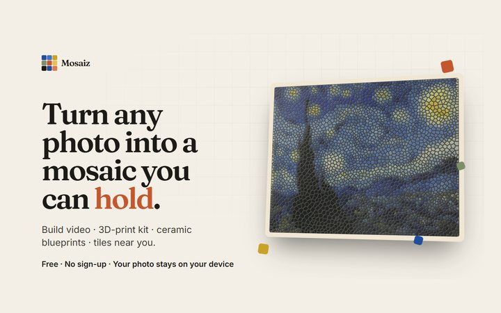</a>
 <b><a href="https://github.com/winchxyz/mosaiz">mosaiz</a></b>
 Turns a photo into a real mosaic, with a build video and a numbered 3D-print kit.
 <a href="https://winchxyz.github.io/mosaiz/">Open</a> &nbsp;·&nbsp; <a href="https://github.com/winchxyz/mosaiz">Code</a>
</td>
</tr>
<tr>
<td width="33%" valign="top">
<a href="https://winchxyz.github.io/platen/">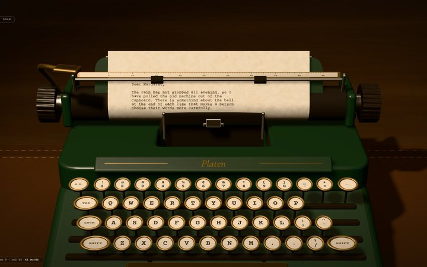</a>
 <b><a href="https://github.com/winchxyz/platen">platen</a></b>
 A 3D manual typewriter. Write, draw typewriter art, or get a guide for your own machine.
 <a href="https://winchxyz.github.io/platen/">Open</a> &nbsp;·&nbsp; <a href="https://github.com/winchxyz/platen">Code</a>
</td>
<td width="33%" valign="top">
<a href="https://winchxyz.github.io/seedplot/">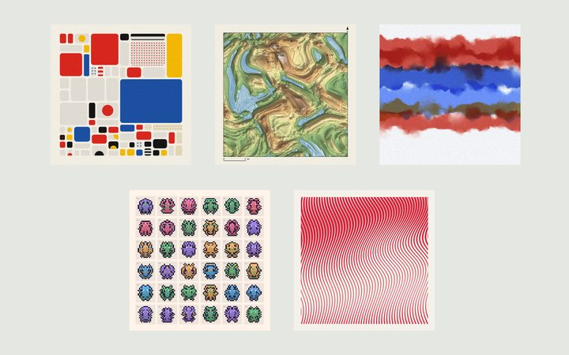</a>
 <b><a href="https://github.com/winchxyz/seedplot">seedplot</a></b>
 A drawing machine with five styles. The same seed always gives the same picture.
 <a href="https://winchxyz.github.io/seedplot/">Open</a> &nbsp;·&nbsp; <a href="https://github.com/winchxyz/seedplot">Code</a>
</td>
<td width="33%" valign="top">
<a href="https://winchxyz.github.io/credits-cubed/">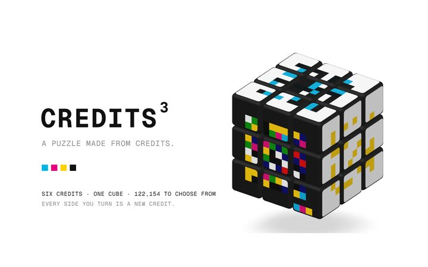</a>
 <b><a href="https://github.com/winchxyz/credits-cubed">credits-cubed</a></b>
 A picture-cube puzzle made from Jack Butcher's Credits, each drawn from its onchain seed.
 <a href="https://winchxyz.github.io/credits-cubed/">Play</a> &nbsp;·&nbsp; <a href="https://github.com/winchxyz/credits-cubed">Code</a>
</td>
</tr>
</table>

## Games

<table>
<tr>
<td width="33%" valign="top">
<a href="https://winchxyz.github.io/moon-rover/">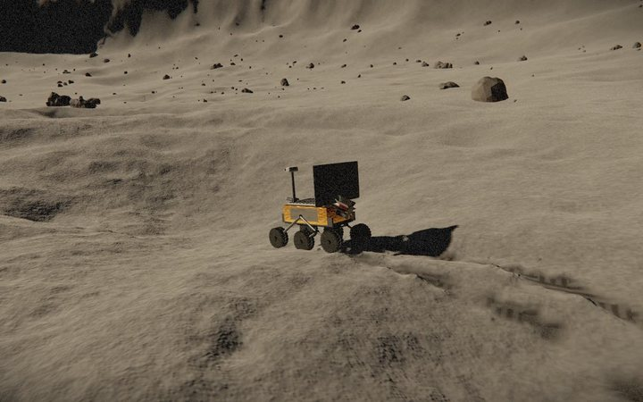</a>
 <b><a href="https://github.com/winchxyz/moon-rover">moon-rover</a></b>
 Drive a rover across the Moon and survey it. Every texture and sound is made in code.
 <a href="https://winchxyz.github.io/moon-rover/">Play</a> &nbsp;·&nbsp; <a href="https://github.com/winchxyz/moon-rover">Code</a>
</td>
<td width="33%" valign="top">
<a href="https://winchxyz.github.io/tidewright/">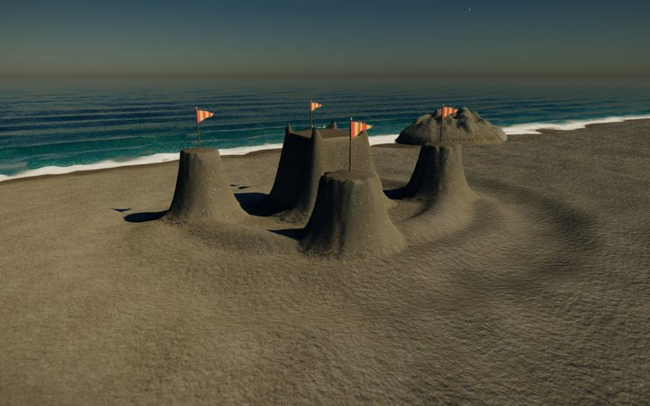</a>
 <b><a href="https://github.com/winchxyz/tidewright">tidewright</a></b>
 Build sandcastles on a beach that runs entirely on the GPU.
 <a href="https://winchxyz.github.io/tidewright/">Play</a> &nbsp;·&nbsp; <a href="https://github.com/winchxyz/tidewright">Code</a>
</td>
<td width="33%" valign="top">
<a href="https://winchxyz.github.io/celadon/">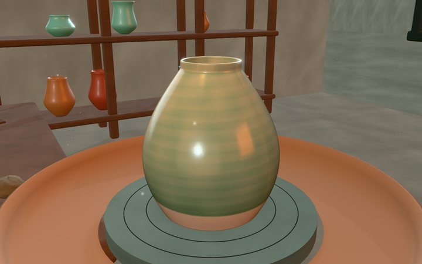</a>
 <b><a href="https://github.com/winchxyz/celadon">celadon</a></b>
 A pottery game: throw a pot on the wheel, mix the glaze, fire the kiln.
 <a href="https://winchxyz.github.io/celadon/">Play</a> &nbsp;·&nbsp; <a href="https://github.com/winchxyz/celadon">Code</a>
</td>
</tr>
<tr>
<td width="33%" valign="top">
<a href="https://winchxyz.github.io/vesper-street/">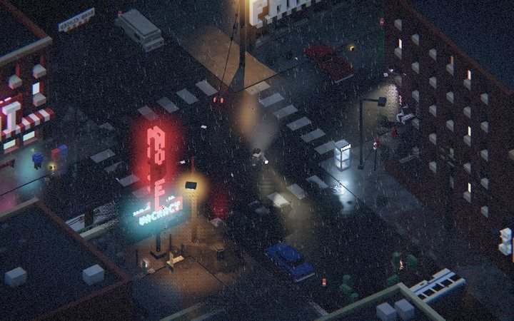</a>
 <b><a href="https://github.com/winchxyz/vesper-street">vesper-street</a></b>
 Isometric survival horror in a drowned voxel town. The flashlight is your only weapon.
 <a href="https://winchxyz.github.io/vesper-street/">Play</a> &nbsp;·&nbsp; <a href="https://github.com/winchxyz/vesper-street">Code</a>
</td>
<td width="33%" valign="top">
<a href="https://winchxyz.github.io/crayon-contraptions/">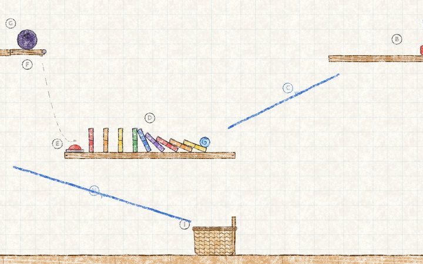</a>
 <b><a href="https://github.com/winchxyz/crayon-contraptions">crayon-contraptions</a></b>
 A Rube Goldberg puzzle game drawn in crayon. 100 levels, seven crayons with their own physics.
 <a href="https://winchxyz.github.io/crayon-contraptions/">Play</a> &nbsp;·&nbsp; <a href="https://github.com/winchxyz/crayon-contraptions">Code</a>
</td>
<td width="33%" valign="top">
<a href="https://winchxyz.github.io/endless-fishing/">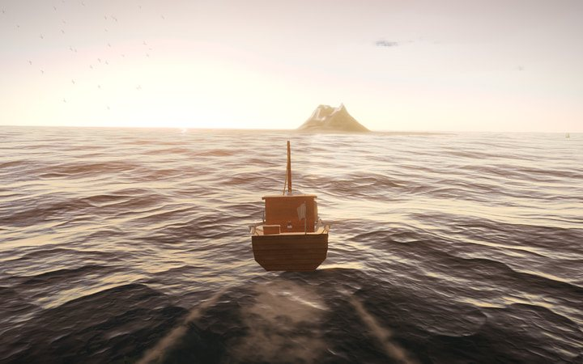</a>
 <b><a href="https://github.com/winchxyz/endless-fishing">endless-fishing</a></b>
 An endless ocean under the same sky that is above you right now.
 <a href="https://winchxyz.github.io/endless-fishing/">Play</a> &nbsp;·&nbsp; <a href="https://github.com/winchxyz/endless-fishing">Code</a>
</td>
</tr>
</table>

## Graphics and video

<table>
<tr>
<td width="33%" valign="top">
<a href="https://winchxyz.github.io/motion-reels/">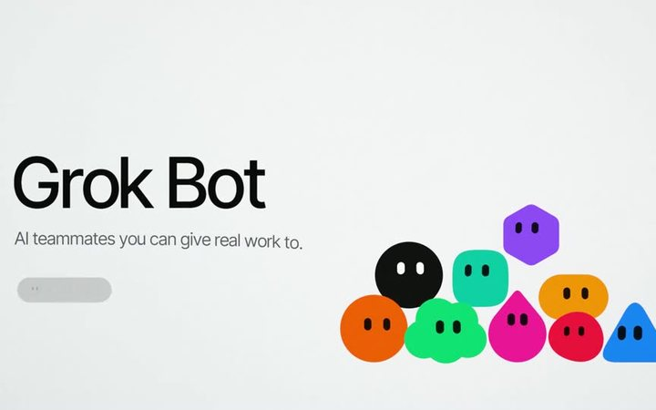</a>
 <b><a href="https://github.com/winchxyz/motion-reels">motion-reels</a></b>
 Short motion videos made with AI and code.
 <a href="https://winchxyz.github.io/motion-reels/">Watch</a> &nbsp;·&nbsp; <a href="https://github.com/winchxyz/motion-reels">Code</a>
</td>
<td width="33%" valign="top">
<a href="https://winchxyz.github.io/navis/">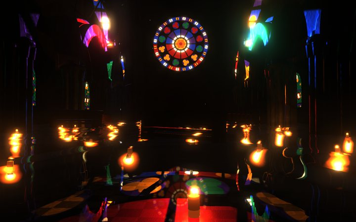</a>
 <b><a href="https://github.com/winchxyz/navis">navis</a></b>
 A flooded Gothic cathedral rendered in real time, in one HTML file.
 <a href="https://winchxyz.github.io/navis/">Open</a> &nbsp;·&nbsp; <a href="https://github.com/winchxyz/navis">Code</a>
</td>
<td width="33%" valign="top">
<a href="https://winchxyz.github.io/aetherflow/">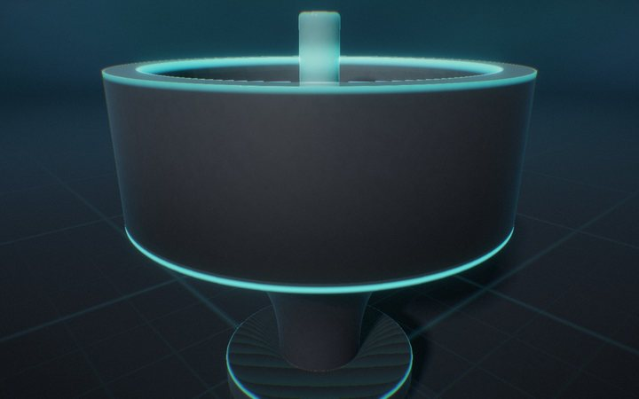</a>
 <b><a href="https://github.com/winchxyz/aetherflow">aetherflow</a></b>
 A 3D fluid lab with real-time refraction and caustics.
 <a href="https://winchxyz.github.io/aetherflow/">Open</a> &nbsp;·&nbsp; <a href="https://github.com/winchxyz/aetherflow">Code</a>
</td>
</tr>
<tr>
<td width="33%" valign="top">
<a href="https://winchxyz.github.io/cut/">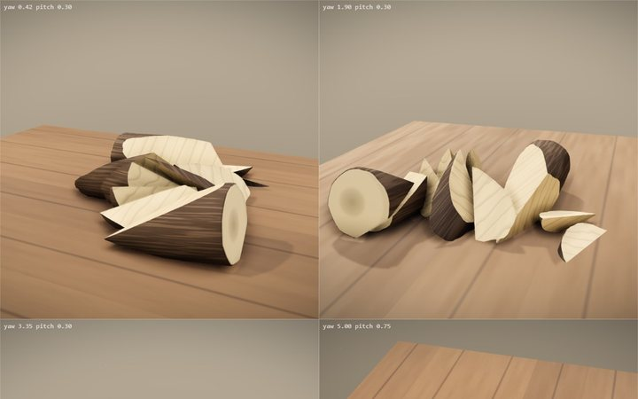</a>
 <b><a href="https://github.com/winchxyz/cut">cut</a></b>
 Slice objects along the exact path your mouse draws.
 <a href="https://winchxyz.github.io/cut/">Play</a> &nbsp;·&nbsp; <a href="https://github.com/winchxyz/cut">Code</a>
</td>
<td width="33%" valign="top">
<a href="https://github.com/winchxyz/solebound">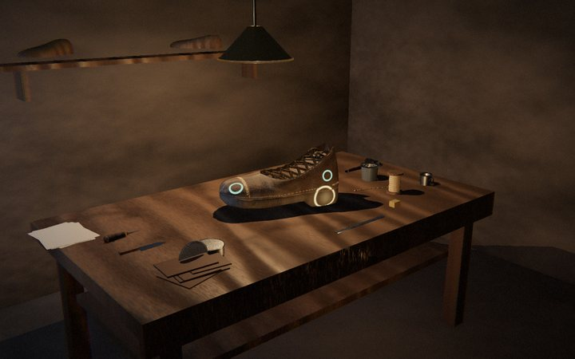</a>
 <b><a href="https://github.com/winchxyz/solebound">solebound</a></b>
 A shoe-repair sim about roads that remember. One HTML file.
 <a href="https://github.com/winchxyz/solebound">Code</a>
</td>
<td width="33%" valign="top">
<a href="https://winchxyz.github.io/ant-farm/">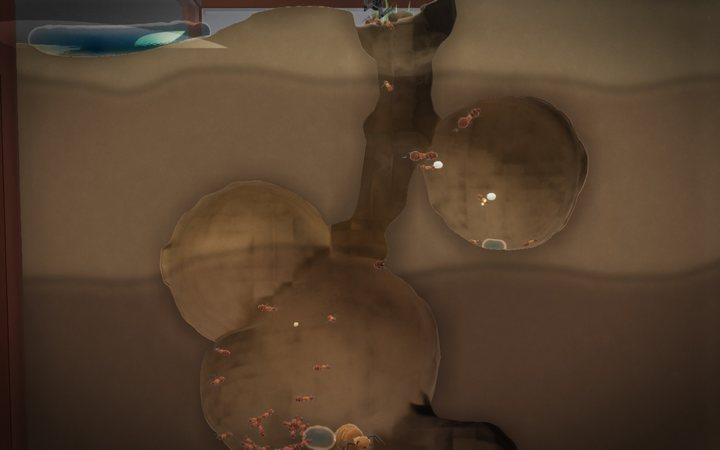</a>
 <b><a href="https://github.com/winchxyz/ant-farm">ant-farm</a></b>
 A 3D ant farm on a hand-written WebGL2 engine.
 <a href="https://winchxyz.github.io/ant-farm/">Play</a> &nbsp;·&nbsp; <a href="https://github.com/winchxyz/ant-farm">Code</a>
</td>
</tr>
</table>

## Also

[zodiac-z13-z32](https://github.com/winchxyz/zodiac-z13-z32) is a reproducible computational attack on two unsolved Zodiac ciphers, negative results included. [ar-butter](https://github.com/winchxyz/ar-butter) lets you crack a stick of butter with your hands through a webcam. [winchxyz.github.io](https://github.com/winchxyz/winchxyz.github.io) is my site, rendered on the GPU.

Every project on this page was built with Claude Code. All repositories: <a href="https://github.com/winchxyz?tab=repositories">github.com/winchxyz</a>
